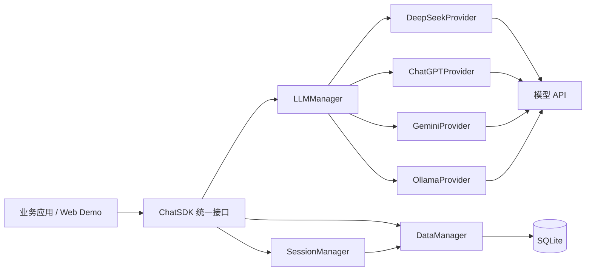

# ai-chat-sdk

C++17 多模型聊天 SDK：一套接口接入 DeepSeek、ChatGPT、Gemini 与本地 Ollama。


## 简介

不同大模型的 HTTP 接口、鉴权方式、流式返回格式各不相同，业务代码每换一家模型就要改一遍。
本项目把这些差异收敛到 SDK 内部：上层只调用 `ChatSDK` 的统一接口，新增模型只需增加一个
Provider，不需要修改业务代码。

SDK 以静态库形式交付，提供头文件、CMake 安装规则和完整示例；仓库内还包含一个基于该 SDK
实现的 Web 聊天助手。

## 解决什么问题

- 多家模型 API 不统一，切换模型需要改业务代码
- 流式响应（SSE）分块解析、粘包处理需要重复实现
- 会话、历史消息、模型配置分散在业务层，难以复用
- 缺少可直接集成、带文档和示例的 C++ 接入层

## 核心特性

- **统一模型接口**：策略模式抽象 Provider，已支持 DeepSeek、ChatGPT、Gemini、Ollama
- **全量与流式响应**：普通返回 + SSE 增量回调两种模式
- **会话管理**：创建会话、会话列表、历史消息、删除会话
- **持久化存储**：SQLite 保存会话与消息，外键级联删除、索引加速、互斥锁保证线程安全
- **工程化交付**：静态库 `libai_chat_sdk.a`，支持 `cmake --install` 与 `find_package`
- **可观测性**：spdlog 日志分级，gflags 管理运行时配置
- **测试与示例**：GoogleTest 单元测试 + 命令行示例 + Web 聊天助手

## 架构



分层说明：

- `ChatSDK`：门面层，对外暴露初始化、会话、发送消息等接口
- `LLMManager`：管理 Provider 注册与模型初始化
- `SessionManager`：管理会话生命周期与消息上下文
- `DataManager`：SQLite 持久化，负责会话与消息的增删查
- `Provider`：各模型的具体协议实现，实现同一个 `LLMProvider` 接口

## 技术栈

| 类别 | 选型 |
|---|---|
| 语言标准 | C++17 |
| 构建 | CMake |
| HTTP | cpp-httplib |
| TLS | OpenSSL |
| JSON | JsonCpp |
| 日志 | spdlog + fmt |
| 存储 | SQLite3 |
| 配置 | gflags |
| 测试 | GoogleTest |

## 目录结构

```
ai-chat-sdk/
├── sdk/
│   ├── include/ai_chat_sdk/   # 对外头文件
│   └── src/                   # SDK 实现
├── server/                    # Web 聊天助手服务端
├── web/                       # 前端页面（HTML/CSS/JS）
├── examples/                  # 命令行示例
├── tests/                     # 单元测试
└── CMakeLists.txt
```

## 快速开始

### 环境要求

- Ubuntu 20.04+
- g++ 9+、CMake 3.16+

```bash
sudo apt update
sudo apt install -y build-essential cmake libssl-dev libjsoncpp-dev \
  libspdlog-dev libfmt-dev libsqlite3-dev libgflags-dev libgtest-dev
```

### 编译并安装 SDK

```bash
git clone https://github.com/<你的用户名>/ai-chat-sdk.git
cd ai-chat-sdk
cmake -B build -DCMAKE_BUILD_TYPE=Release
cmake --build build -j
sudo cmake --install build
```

安装后得到：

```
/usr/local/lib/libai_chat_sdk.a
/usr/local/include/ai_chat_sdk/*.h
```

### 在自己的项目中使用

```cpp
#include <ai_chat_sdk/chat_sdk.h>
#include <cstdlib>
#include <iostream>

int main() {
    ai_chat_sdk::ChatSDK sdk;

    auto config = std::make_shared<ai_chat_sdk::ApiConfig>();
    config->model_name  = "deepseek-chat";
    config->api_key     = std::getenv("DEEPSEEK_API_KEY");
    config->temperature = 0.7;
    config->max_tokens  = 2048;

    sdk.initModels({config});
    auto sessionId = sdk.createSession("deepseek-chat");

    sdk.sendMessageStream(sessionId, "你好，介绍一下你自己",
        [](const std::string& chunk, bool done) {
            std::cout << chunk << std::flush;
        });
    return 0;
}
```

链接时加上：

```cmake
target_link_libraries(your_app PRIVATE
    ai_chat_sdk fmt jsoncpp sqlite3
    OpenSSL::SSL OpenSSL::Crypto spdlog gflags)
```

### 运行 Web 聊天助手

```bash
cmake -B build -DCMAKE_BUILD_TYPE=Release
cmake --build build -j
./build/chat_server --port=8080
```

浏览器打开 `http://localhost:8080`，支持新建会话、切换模型、流式对话、查看历史、删除会话。

## HTTP 接口

| 方法 | 路径 | 说明 |
|---|---|---|
| GET | `/api/models` | 获取可用模型 |
| GET | `/api/sessions` | 获取会话列表 |
| POST | `/api/session` | 新建会话 |
| GET | `/api/session/{id}/history` | 获取历史消息 |
| DELETE | `/api/session/{id}` | 删除会话 |
| POST | `/api/message` | 发送消息，全量返回 |
| POST | `/api/message/async` | 发送消息，SSE 流式返回 |

## 设计说明

- **Provider 策略模式**：`LLMProvider` 定义初始化、可用性检测、全量/流式发送接口；
  新增模型只需实现一个 Provider，并在 `LLMManager` 注册，调用方零改动。
- **SSE 流式解析**：通过 httplib 的 `content_receiver` 接收分块数据，按行拆分 `data:`，
  过滤空行与 `[DONE]`，增量回调给上层；未完成的半行留在 buffer 中等待下一块。
- **SQLite 持久化**：`sessions` 与 `messages` 两张表，`messages.session_id` 建索引，
  外键设置 `ON DELETE CASCADE`；所有数据库操作加互斥锁，避免多线程竞争。
- **SDK 交付**：CMake 生成静态库并声明 `install` 规则，安装头文件到
  `/usr/local/include/ai_chat_sdk`，使用者只需链接一个库。

## 测试

```bash
cmake -B build -DCMAKE_BUILD_TYPE=Debug -DBUILD_TESTING=ON
cmake --build build -j
ctest --test-dir build --output-on-failure
```

覆盖点：模型初始化、全量返回、流式返回、会话增删查、数据库读写。

## Roadmap

- [ ] Tool Calling / Function Calling
- [ ] 异步请求与连接池
- [ ] 接入 Qwen、豆包等更多模型
- [ ] Windows / macOS 支持
- [ ] 首 token 延迟与吞吐压测
- [ ] 用户体系与鉴权

## License

MIT

## 说明

本项目为个人学习项目，与 DeepSeek、OpenAI、Google、Ollama 官方无关。
使用时请遵守各模型厂商的服务条款，不要将 API Key 提交到仓库。
